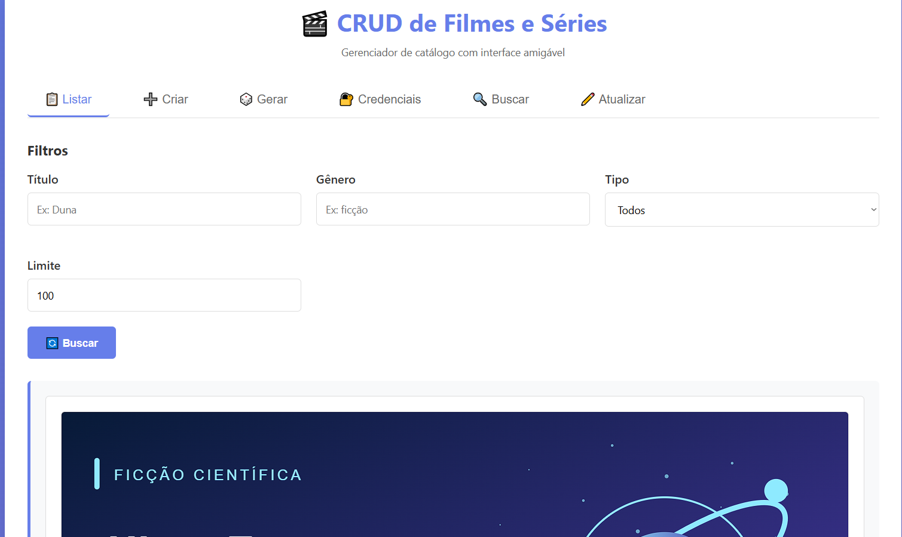

# CRUD de Filmes e Séries

Projeto de estudo em Python desenvolvido a partir da disciplina de **Algoritmos e Programação**, ministrada por **Rondineli Seba Salomão**, na UNDB. O catálogo permite cadastrar, consultar, atualizar e excluir filmes e séries.

A versão ampliada utiliza FastAPI, HTML/CSS/JavaScript e SQLite com SQLModel. Inclui filtros, geração de mídias fictícias, credenciais demonstrativas, a regra de “Vingadores: Ultimato”, testes e configuração Docker. **Docker ainda não foi executado nem validado.**

- [Demonstração publicada](https://algoritmos-e-programa-o.vercel.app/): versão publicada a partir da `main`, com catálogo temporário.
- [Documentação da versão de portfólio](docs/DOCUMENTACAO-PORTFOLIO.md): instalação, execução, API, testes, Docker e limitações.

Conheça os [aprendizados, decisões de escopo e meu interesse em front-end](docs/DOCUMENTACAO-PORTFOLIO.md#minha-decisão-de-criar-o-front-end).

## Organização do repositório

- **CRUD de portfólio:** a aplicação, a interface e as configurações de execução ficam na raiz; os testes ficam em `tests/`.
- **[AULAS/](AULAS/README.md):** exercícios independentes da disciplina, com os conceitos estudados e instruções para executar.
- **[docs/](docs/DOCUMENTACAO-PORTFOLIO.md):** documentação detalhada do CRUD; materiais antigos ficam em `docs/historico/`.

## Versões didáticas da disciplina

| Etapa | Branch | Conteúdos |
|---|---|---|
| Ciclo 1 | [ciclo-1--terminal](https://github.com/pedruck9-crypto/algoritmos-e-programacao/tree/ciclo-1--terminal) | Variáveis, operadores, condicionais e laços. |
| Ciclo 2 | [ciclo-2-estruturas-dinâmicas](https://github.com/pedruck9-crypto/algoritmos-e-programacao/tree/ciclo-2-estruturas-din%C3%A2micas) | Refatoração e estruturas dinâmicas. |
| Ciclo 3 | [ciclo-3-funções](https://github.com/pedruck9-crypto/algoritmos-e-programacao/tree/ciclo-3-fun%C3%A7%C3%B5es) | Organização em funções e aplicação final. |

Cada branch didática possui seu próprio README com instruções para o terminal. Elas foram organizadas por ciclo após o desenvolvimento da versão ampliada; não representam necessariamente a sequência histórica das implementações.

## Contexto e escopo

Na primeira etapa, o escopo ainda não estava claramente delimitado para mim. Desenvolvi recursos além dos conteúdos previstos e, assim que o escopo foi esclarecido pelo professor, reorganizei o projeto nas três branches didáticas.

A API web, a interface gráfica, o ORM, o banco de dados, as credenciais demonstrativas, os testes e o Docker pertencem à evolução para portfólio. As branches dos ciclos apresentam o recorte da disciplina para avaliação.

Desenvolvido por **Pedro Lucas Pereira Rolim**, estudante de Sistemas de Informação com interesse profissional em desenvolvimento front-end.
